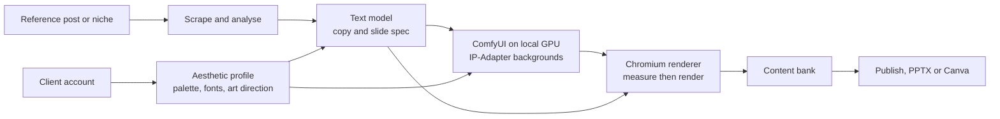

# Social Studio

**Brand-consistent social media content, generated on your own GPU instead of paid per token.**

Social Studio is a content operations platform for agencies and community managers. It analyses
what already works in a niche, learns each client's visual identity, and produces ready-to-publish
carousels, stories and reel scripts. Images are generated by a self-hosted ComfyUI server on a
dedicated GPU, so the marginal cost of every image is close to zero.


---

## Why it is different

Most AI content tools call a hosted image model and bill per image or per token. Social Studio
takes a different route:

- **Self-hosted image generation.** Backgrounds are rendered by [ComfyUI](https://github.com/comfyanonymous/ComfyUI)
  with an IP-Adapter style-conditioning workflow running on a local GPU
  ([ADR 0010](docs/architecture/adr/0010-comfyui-ip-adapter-image-provider.md)). Hosted image models
  remain available behind the same port when you want them.
- **Brand fidelity, not generic output.** The platform extracts each client's palette, typography
  and art direction from their existing posts, confirms fonts by visual comparison, and conditions
  every generated image on that profile.
- **Text is composited, never hallucinated into pixels.** Copy is laid out with HTML/CSS and
  rendered by Chromium in two passes (measure, then render), so text stays sharp and editable
  ([ADR 0016](docs/architecture/adr/0016-two-pass-measure-then-render.md)).
- **Provider-agnostic AI.** Text models, image models, scrapers and publishers are all adapters
  behind ports, configured per organization.

## Features

| Area | What it does |
| --- | --- |
| **Content generation** | Turns an analysed reference post into feed carousels, single posts, stories and reel scripts adapted to a client's brand manual and strategy. |
| **Client aesthetic profile** | Analyses a client's account to extract colours, fonts, image types and art-direction method, then reuses it for every generation. |
| **Single content analyzer** | Scrapes a post or video by URL, transcribes it and maps hook, format, angle and CTA into a reusable analysis. |
| **Profile analyzer** | Analyses a whole Instagram account: engagement metrics, AI marketing insights and a charted dashboard. |
| **Content bank & publishing** | Plans generated pieces and publishes through external providers; exports editable PPTX or sends designs to Canva. |
| **Niche discovery** | Samples YouTube by region and category and scores channel-launch opportunities with explicit evidence and confidence. |
| **Multi-tenant workspace** | Organizations, clients, users, roles and per-organization integration credentials (encrypted at rest). |

## How it works



## Tech stack

- **Backend:** ASP.NET Core on .NET 10, hexagonal architecture (Domain, Application, Infrastructure, API), EF Core with PostgreSQL.
- **Orchestration:** .NET Aspire AppHost for local development.
- **Frontend:** Next.js (App Router), React, TypeScript, Tailwind CSS, shadcn/ui, Radix, Framer Motion.
- **Image generation:** ComfyUI with IP-Adapter workflows; optional hosted image models.
- **Rendering:** Playwright Chromium for deterministic slide rendering with embedded open-licensed fonts.
- **Integrations:** Apify (scraping), YouTube Data API, Anthropic, OpenAI, Gemini, Canva, Blotato, Supabase Storage. All are optional adapters.
- **Quality:** PowerShell quality gates (secrets, architecture boundaries, migrations drift, tests) run locally and in CI.

## Repository layout

```txt
apps/web/                      Next.js dashboard
SocialStudio.Domain/           Entities, value objects, domain rules
SocialStudio.Application/      Use cases, commands/queries, ports
SocialStudio.Infrastructure/   EF Core, AI providers, ComfyUI, renderer, integrations
SocialStudio.ApiService/       ASP.NET Core HTTP API
SocialStudio.AppHost/          .NET Aspire local orchestration
SocialStudio.ServiceDefaults/  Shared Aspire service defaults
SocialStudio.Tests/            Unit and integration tests
docs/                          PRD, SDD, ADRs, diagrams, setup guides
openspec/                      Spec-driven change proposals and archived specs
scripts/                       Local launcher, database and quality-gate scripts
```

## Getting started

> Social Studio is published as a portfolio project. It is complete enough to read, build and
> run locally, but it is not packaged for production deployment.

### Prerequisites

- .NET 10 SDK
- Node.js 22 and pnpm
- Docker (local PostgreSQL)
- Optional: an NVIDIA GPU with ComfyUI for image generation ([setup guide](docs/infrastructure/comfyui/setup.md))

### Configuration

No real credentials are stored in the repository. Every secret is a placeholder you replace locally.

| Setting | Where | Example |
| --- | --- | --- |
| `ConnectionStrings__Postgres` | user secrets or env var | `Host=localhost;Port=5433;Database=social_studio_dev;Username=postgres;Password=<your-password>` |
| `Authentication__Jwt__Secret` | user secrets or env var | any random string of 32+ characters |
| `SeedUsers__SysAdmin__Password` | user secrets or env var | initial admin password |
| `NEXT_PUBLIC_API_BASE_URL` | `apps/web/.env.local` (copy from `.env.example`) | `http://localhost:5336` |
| AI, scraping and publishing keys | **Settings → Integrations** in the app, per organization | stored encrypted in the database |

Set backend secrets with .NET user secrets:

```powershell
dotnet user-secrets --project SocialStudio.ApiService set "Authentication:Jwt:Secret" "<32+ random characters>"
dotnet user-secrets --project SocialStudio.ApiService set "SeedUsers:SysAdmin:Password" "<admin password>"
```

The development profile already points at the local Docker PostgreSQL defined in
`docker-compose.dev.yml`, which uses development-only credentials.

### Run everything

```powershell
pwsh -File scripts/dev/Start-Studio.ps1
```

The launcher checks tooling, starts Docker and PostgreSQL, installs the Playwright Chromium,
starts ComfyUI (when found), the Aspire AppHost and the Next.js frontend. Useful switches:
`-SkipComfyUI`, `-SkipBackend`, `-SkipFrontend`, `-RecreateDb`, `-FullStartup`, `-NoBrowser`.

| Service | URL |
| --- | --- |
| Frontend | http://localhost:3000 |
| API | http://localhost:5336 |
| Aspire dashboard | http://localhost:15161 |
| ComfyUI | http://127.0.0.1:8188 |

ComfyUI is located through `-ComfyUIRoot` or the `HIVE_COMFYUI_ROOT` environment variable;
override its launch flags with `HIVE_COMFYUI_ARGS`.

### Run pieces individually

```powershell
# API only
dotnet run --project SocialStudio.ApiService --launch-profile http-fast

# Aspire AppHost (API + frontend)
dotnet run --project SocialStudio.AppHost

# Frontend only
cd apps/web
pnpm install
pnpm dev
```

Apply database migrations manually:

```powershell
dotnet dotnet-ef database update `
  --project SocialStudio.Infrastructure `
  --startup-project SocialStudio.ApiService `
  --context SocialStudio.Infrastructure.Identity.AppIdentityDbContext
```

### Quality gates

```powershell
pwsh -File scripts/gates/Run-Gates.ps1
```

See [docs/quality-gates.md](docs/quality-gates.md) for the gate catalogue.

## Documentation

| Document | Content |
| --- | --- |
| [docs/PRD.md](docs/PRD.md) | Product requirements and acceptance criteria |
| [docs/SDD.md](docs/SDD.md) | System design: layers, bounded contexts, persistence |
| [docs/architecture/adr/](docs/architecture/adr/) | Architecture decision records |
| [docs/architecture/diagrams/](docs/architecture/diagrams/) | Architecture and flow diagrams |
| [docs/infrastructure/comfyui/setup.md](docs/infrastructure/comfyui/setup.md) | ComfyUI installation and workflows |
| [openspec/](openspec/) | Spec-driven changes, including archived proposals and verification reports |
| [AGENTS.md](AGENTS.md) | Rules for AI coding agents working in this repository |

## Project history

Social Studio started as **Incoders Hive**, an internal platform at Incoders, and was later
published as an open-source portfolio project. The full commit history is preserved. Client
names and uploaded client assets were anonymized or removed before publication, and internal
module keys (for example `hive-social`) keep their original names because they are stored data.

The project was built with an AI-assisted, spec-driven workflow: every significant change has an
OpenSpec proposal, design and verification report under `openspec/`, and architectural decisions
are recorded as ADRs.

## License

[MIT](LICENSE) © 2026 Patricio Montes. Bundled fonts and third-party components keep their own
licenses; see [THIRD-PARTY-NOTICES.md](THIRD-PARTY-NOTICES.md).
