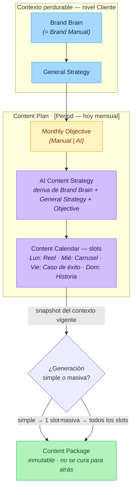

# Content Plan — flujo conceptual

Cómo se llega a generar un **Content Package** a partir del contexto del cliente.
Diseño asociado: [`ADR 0002 — client-content-plan-model`](../adr/0002-client-content-plan-model.md).

> Fuente editable: [`content-plan-flow.excalidraw`](./content-plan-flow.excalidraw) (abrir en https://excalidraw.com).
> El Mermaid de abajo es la versión que renderiza directo en GitHub y es la fuente versionada de referencia.

## Leyenda

- **Brand Brain / General Strategy** — contexto perdurable a nivel cliente; se define al inicio y casi no cambia.
- **Content Plan** — agregado por período (hoy mensual; el período es un Value Object, no está atado a la cadencia). Contiene:
  - **Objective** — objetivo + KPIs del período (manual o IA).
  - **Content Strategy** — estrategia táctica del período, generada/refinada por IA.
  - **Content Calendar** — slots `día → formato`; cada slot es una unidad de generación.
- Cada nodo lleva **`Provenance` `{ Source: Manual | AI, GeneratedAt, Status }`** como traza de auditoría (no bloqueante).
- **Generación**: *simple* = 1 slot; *masiva* = todos los slots. Toma un **snapshot** del contexto vigente y produce el **Content Package**, que es **inmutable** (no se cura para atrás).
