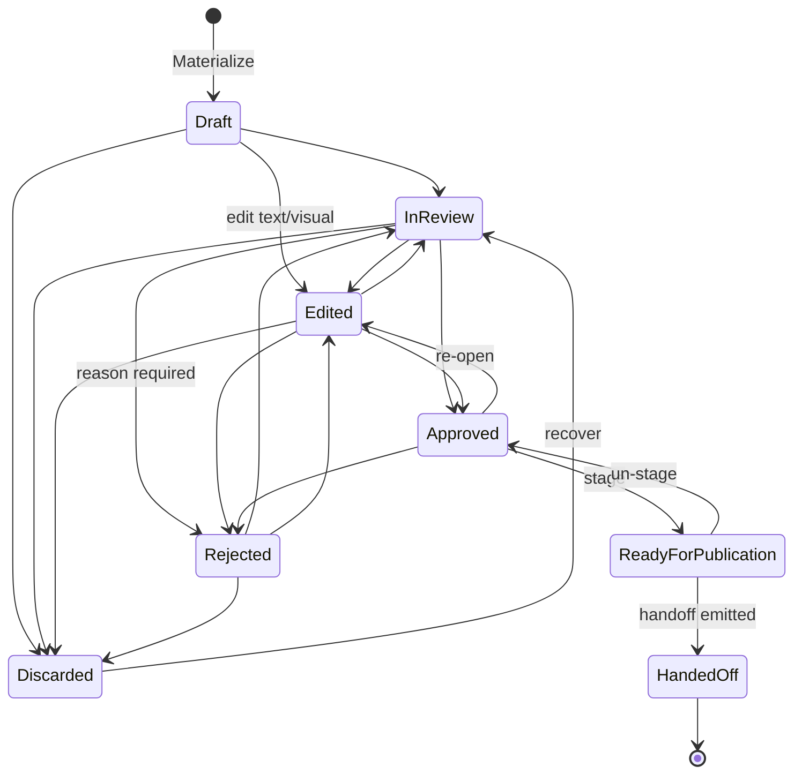
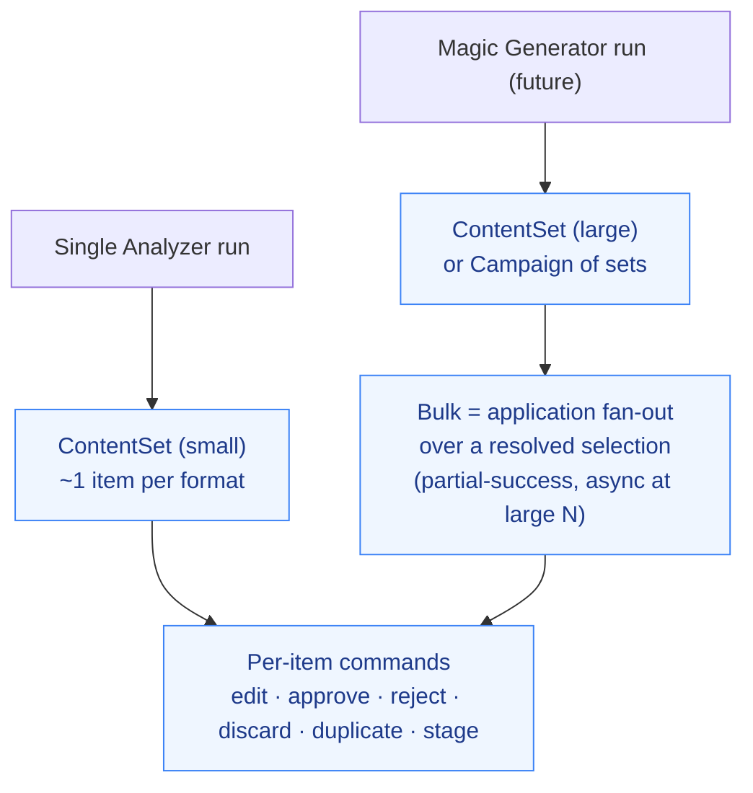

# Content Studio — Flow & Responsibility Diagram

> Change: `content-studio` (Phase 1). ADR: [`docs/architecture/adr/0004-content-studio-review-model.md`](../adr/0004-content-studio-review-model.md).
> Companion design: `openspec/changes/content-studio/design.md`.

Content Studio is the **post-generation editorial surface**: it derives an editable, reviewable working copy from **immutable** generation output, runs an approval lifecycle, and hands approved content off to publishing. It is **source-agnostic** (any generator), **isolated** (no `SingleAnalyzer` types, no `ContentGeneration` internals), and it **never publishes**.

## 1. End-to-end flow

**Boundaries enforced**
- **Immutability**: the materializer only *reads* `GeneratedPackage`/format results; Content Studio never writes them (CS-10, CG-READ-02).
- **Context isolation**: `Domain/Social/ContentStudio/` references *no* `SingleAnalyzer` type and *no* `ContentGeneration` internal type — only soft `Guid`s via `ContentOrigin` (mirrors ProfileAnalysis PA-REG-01).
- **Responsibility ends at handoff**: Content Studio emits the payload and marks `HandedOff`; it performs no scheduling/publishing (PUB-HANDOFF-02).

## 2. ReviewState lifecycle

Transitions are enforced by a static `ReviewStateTransitions` table (same pattern as `ProfileAnalysisStatusTransitions`). Any move not in the table returns a structured `ContentStudioErrors.IllegalReviewTransition` (→ HTTP 409 `content-studio.illegal_transition`), never a silent no-op. `HandedOff` is terminal.

## 3. Individual ↔ bulk is cardinality, not a different model

A Single Analyzer run is a small `ContentSet`; Magic Generator is a large set (or a `Campaign`). Bulk operations are an application-layer fan-out over the **same** `ContentItem` aggregate and the **same** per-item commands — there is no separate "bulk" model, which is what lets generation scale from one piece to many without a redesign.
