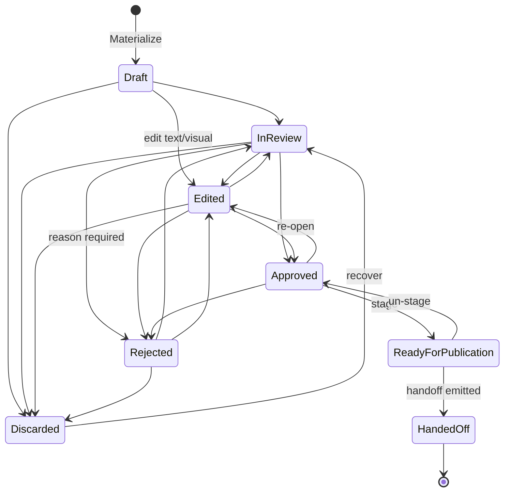
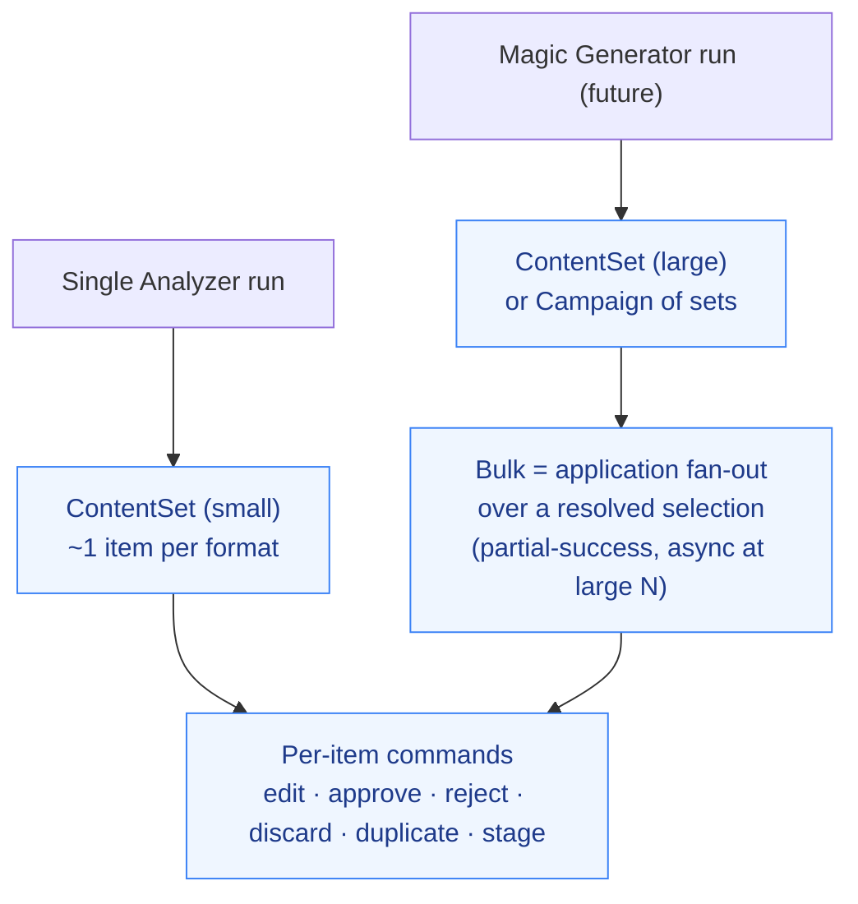
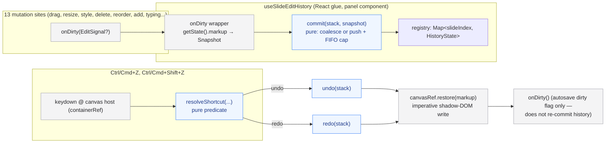

# Content Studio — Flow & Responsibility Diagram

> Change: `content-studio` (Phase 1). ADR: [`docs/architecture/adr/0004-content-studio-review-model.md`](../adr/0004-content-studio-review-model.md).
> Companion design: `openspec/changes/content-studio/design.md`.

Content Studio is the **post-generation editorial surface**: it derives an editable, reviewable working copy from **immutable** generation output, runs an approval lifecycle, and hands approved content off to publishing. It is **source-agnostic** (any generator), **isolated** (no `SingleAnalyzer` types, no `ContentGeneration` internals), and it **never publishes**.

## 1. End-to-end flow

```mermaid
flowchart LR
  subgraph Producers["Generators (producers)"]
    SA["Single Analyzer<br/>GeneratorKind = SingleAnalyzer"]
    MG["Magic Generator<br/>(future) GeneratorKind = MagicGenerator"]
  end

  subgraph Gen["content-generation — IMMUTABLE (generate-once)"]
    GP["GeneratedPackage<br/>+ durable per-format results<br/>(story/carousel PPTX, reel-script MD, caption, hook...)"]
  end

  SA --> GP
  MG -. future .-> GP

  subgraph Studio["content-studio — editorial working surface (this change)"]
    MAT["ContentItemMaterializer<br/>read-only · idempotent · lazy on open"]
    CS["ContentSet (GenerationRun)<br/>ReviewSummary roll-up"]
    CI["ContentItem*<br/>ContentDraft (editable)<br/>ReviewState machine"]
  end

  GP == "read contract (CG-READ-01)<br/>soft ContentOrigin (Guids only)" ==> MAT
  MAT --> CS
  CS -- "soft member refs" --> CI

  subgraph Pub["publishing — (future, stub today)"]
    PL["Publication pipeline<br/>draft → provider → status"]
  end

  CI == "Approved → ReadyForPublication<br/>event ContentApprovedForPublication<br/>port IPublicationHandoff<br/>PublicationHandoffPayload (SchemaVersion=1)" ==> PL

  CI -. "PlanContext — Phase 4 (soft)" .-> CP["ContentPlan.CalendarSlot"]

  classDef immutable fill:#f4f4f5,stroke:#a1a1aa,color:#27272a;
  classDef studio fill:#eff6ff,stroke:#3b82f6,color:#1e3a8a;
  classDef future fill:#fff7ed,stroke:#f59e0b,color:#7c2d12;
  class GP immutable;
  class MAT,CS,CI studio;
  class MG,PL,CP future;
```

**Boundaries enforced**
- **Immutability**: the materializer only *reads* `GeneratedPackage`/format results; Content Studio never writes them (CS-10, CG-READ-02).
- **Context isolation**: `Domain/Social/ContentStudio/` references *no* `SingleAnalyzer` type and *no* `ContentGeneration` internal type — only soft `Guid`s via `ContentOrigin` (mirrors ProfileAnalysis PA-REG-01).
- **Responsibility ends at handoff**: Content Studio emits the payload and marks `HandedOff`; it performs no scheduling/publishing (PUB-HANDOFF-02).

## 2. ReviewState lifecycle

Transitions are enforced by a static `ReviewStateTransitions` table (same pattern as `ProfileAnalysisStatusTransitions`). Any move not in the table returns a structured `ContentStudioErrors.IllegalReviewTransition` (→ HTTP 409 `content-studio.illegal_transition`), never a silent no-op. `HandedOff` is terminal.

## 3. Individual ↔ bulk is cardinality, not a different model

A Single Analyzer run is a small `ContentSet`; Magic Generator is a large set (or a `Campaign`). Bulk operations are an application-layer fan-out over the **same** `ContentItem` aggregate and the **same** per-item commands — there is no separate "bulk" model, which is what lets generation scale from one piece to many without a redesign.

## 4. Frontend canvas edit history (undo/redo)

The visual editor (`DesignCanvas` in `apps/web/components/social/content-studio-panel.tsx`) is a client-only, imperative-DOM surface — it is not part of the backend domain above. Undo/redo is bounded entirely to this component tree; it does not touch `ContentDraft`/`ReviewState` and does not persist across item switches or page reloads.

**Ownership**: all policy (the `{past, present, future}` stack reducer, the per-slide registry, the typing-coalescing window, the 50-entry depth cap, the shortcut predicate) lives in the pure module `apps/web/lib/studio/edit-history.ts`, unit-tested with the Node test runner (no jsdom in this repo). The panel component (`useSlideEditHistory`) and `DesignCanvas` are DOM/React glue only — every conditional in the glue layer is a guard on a pure function's return value, never a computed threshold or state transition.

**Per-slide keying**: history is keyed by slide index, not by `DesignCanvas`'s `key={item.id}` — the canvas does not remount on slide navigation (`goTo` only swaps the `markup` prop), so a single stack would silently mix slides. Switching the selected item remounts the editor component (`ItemDetail key={selected.id}`), which naturally clears history — no explicit code required.

**Restore path**: undo/redo never write back through the `markup` prop (a value that equals the current prop is a no-op React never re-runs). `DesignCanvasHandle.restore(markup)` writes `shadow.innerHTML` imperatively and invalidates the current selection, mirroring the existing prop-driven effect's own invalidation.

**Reachability**: Undo/Redo controls live in the existing always-mounted `data-cs-add` action row (`canEdit`-gated only, never `selRect`-gated), so they remain reachable immediately after a delete clears the selection.
