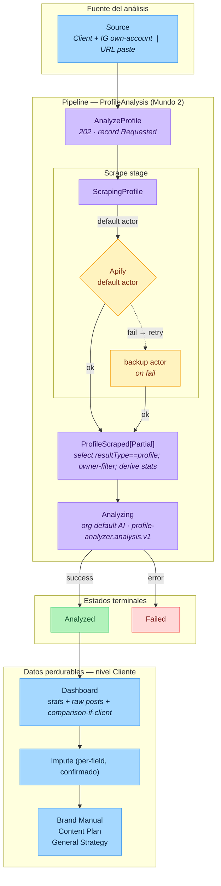

# Profile Analysis — flujo del pipeline (Mundo 2)

Cómo se pasa de una fuente Instagram a un `ProfileAnalysis` con análisis de IA, dashboard de métricas e imputación de campos al cliente.
Diseño asociado: [`ADR 0003 — profile-analysis-model`](../adr/0003-profile-analysis-model.md).

> Fuente editable: [`profile-analysis-flow.excalidraw`](./profile-analysis-flow.excalidraw) (abrir en https://excalidraw.com).
> El Mermaid de abajo es la versión que renderiza directo en GitHub y es la fuente versionada de referencia.

## Leyenda

- **Fuente (azul)** — punto de entrada del pipeline; el nodo `Source` agrupa las dos rutas de entrada (client+own-account vs. URL paste).
- **Pipeline (morado)** — etapas de procesamiento en background: `AnalyzeProfile` (202 + encola el job), `ScrapingProfile` (Apify actor), `ProfileScraped[Partial]` (filtro por owner + derivación de stats), `Analyzing` (AI).
- **Decisión / fallback (ámbar)** — si el actor por defecto falla, se reintenta automáticamente con el backup actor (una sola vez, mismo run). Solo aplica al path `variantKey="profile"`. El pipeline de single-video no se ve afectado.
- **Estados terminales (verde/rojo)** — `Analyzed` (éxito) o `Failed` (ambos actores fallaron, o error de AI / config). Ambos persisten `ProviderDiagnosticsJson` con el shape PA-23 completo.
- **Datos perdurables (azul)** — tras `Analyzed`, el Dashboard expone stats + raw posts + comparison-if-client; el operador puede imputar campos detectados por IA al Brand Manual, Content Plan o General Strategy del cliente.

## Notas de implementación

| Aspecto | Decisión |
|---|---|
| Namespace | `Domain/Social/ProfileAnalysis/` — aislado de `SingleAnalyzer` (PA-REG-01) |
| Actor routing | `variantKey="profile"` en `actor_mappings_json` — NO reutiliza la entrada de single-video |
| Fallback | Automático: default → backup una vez en el mismo run (Design Decision 3) |
| AI flow key | `profile-analyzer.analysis.v1` — distinto de `single-analyzer.analysis.v1` |
| Diagnostics | `ProfileRunDiagnostics` POJO serializado en `ProviderDiagnosticsJson` en todos los terminales |
| Impute | Reutiliza comandos existentes de BrandManual/ContentPlan/GeneralStrategy — idempotente |
