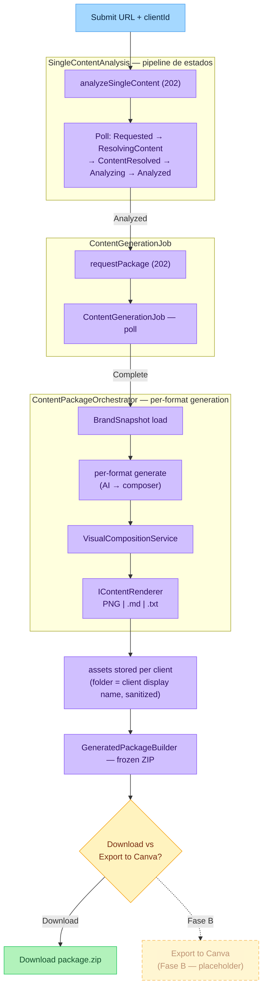

# Single Analyzer — happy path (Fase A)

Cómo se pasa de un URL de contenido a un `package.zip` descargable, con la rama de exportación a Canva marcada como placeholder de Fase B.
Diseño asociado: [`design.md`](../../../openspec/changes/single-analyzer-fase-a/design.md).

> Fuente editable: [`single-analyzer-flow.excalidraw`](./single-analyzer-flow.excalidraw) (abrir en https://excalidraw.com).
> El Mermaid de abajo es la versión que renderiza directo en GitHub y es la fuente versionada de referencia.

> **Nota:** Ambas ramas (`Download` y `Export to Canva`) deben producir formatos compatibles con Canva. La integración directa con Canva está fuera del alcance de Fase A.

## Leyenda

- **Entrada (azul)** — el nodo `Submit URL + clientId` es el punto de entrada del pipeline. `clientId` es opcional; sin él, no se puede generar el paquete de contenido.
- **Pipeline (morado)** — etapas de procesamiento:
  - `analyzeSingleContent (202)` — encola el job de análisis y devuelve inmediatamente.
  - Poll de estados `Requested → ResolvingContent → ContentResolved → Analyzing → Analyzed` — el frontend poll hasta `Analyzed`.
  - `requestPackage (202)` — encola el `ContentGenerationJob` y devuelve inmediatamente.
  - `ContentPackageOrchestrator` — orquesta la generación por formato: carga el `BrandSnapshot`, invoca el AI composer por formato, pasa el resultado a `VisualCompositionService`, renderiza via `IContentRenderer`.
  - `IContentRenderer` — branch por `OutputKind`: `Text` → `.txt`, `Markdown` → `.md` (`reel-script.md`, `text/markdown; charset=utf-8`), default → raster PNG.
  - `assets stored per client` — assets almacenados con carpeta = nombre display del cliente (sanitizado, no slugificado).
  - `GeneratedPackageBuilder` — construye el ZIP inmutable (`frozen`).
- **Decisión (ámbar)** — `Download vs Export to Canva?` — el nodo de decisión terminal.
- **Terminal verde** — `Download package.zip` — ruta disponible en Fase A.
- **Placeholder Fase B (ámbar punteado)** — `Export to Canva` — fuera del alcance de Fase A; reservado para integración directa con la API de Canva.

## Notas de implementación

| Aspecto | Decisión |
|---|---|
| `reel-script` output | `OutputKind = Markdown` → archivo `reel-script.md`, MIME `text/markdown; charset=utf-8`, timestamps en negrita `**0:00**`, emojis preservados verbatim |
| Folder de cliente (ZIP) | `NormalizeFolderName(client.Name)` — sanitize-only: elimina 9 chars ilegales + C0/0x7F, trim leading/trailing dot y espacio, guard de device names (NUL→NUL\_). Sin slugificación, sin ToLowerInvariant |
| Folder de cliente (Assemble) | `AssembleGeneratedPackageQueryHandler` resuelve el nombre via `ISocialClientRepository.GetByIdAsync` — mismo `NormalizeFolderName`, fallback a GUID si el cliente no existe |
| `IContentRenderer` branch order | `Text` → `.txt` first, luego `Markdown` → `.md`, default → raster PNG |
| Canva | Ambas ramas producen formatos Canva-compatibles; la integración directa es Fase B |
| Spec IDs cubiertos | RS-01, RS-02, RS-03 (Markdown reel-script), PKG-01, PKG-02 (display-name folders), DIAG-01 (este diagrama) |
