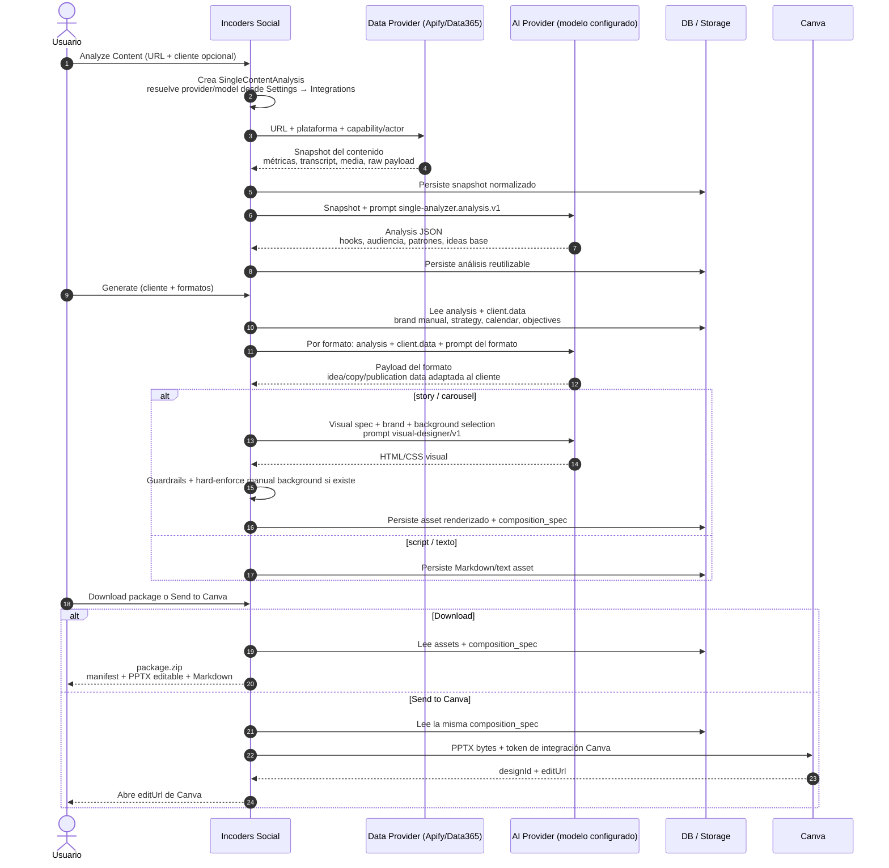

# Single Analyzer — flujo de responsabilidades

Mapa simple para entender **quién hace qué** desde que un usuario analiza un contenido hasta que descarga el paquete o lo envía a Canva.
La fuente editable es [`single-analyzer-flow.excalidraw`](./single-analyzer-flow.excalidraw).

La idea central: **Opus no es una dependencia del flujo**. El agente/modelo usado para análisis, generación y diseño visual se resuelve desde la configuración de la organización en **Settings → Integrations**.

## Lectura rápida

| Momento | Responsable | Datos que viajan | Resultado |
|---|---|---|---|
| Analyze Content | Incoders Social + Data Provider | URL, plataforma, actor/capability | Snapshot normalizado del contenido |
| AI Analysis | Incoders Social + AI configurada | Snapshot + prompt `single-analyzer.analysis.v1` | Hooks, patrones, audiencia, ideas base |
| Generate | Incoders Social + AI configurada | Analysis + `client.data` + formatos | Payload adaptado por formato |
| Visual Design | Incoders Social + AI configurada | Spec visual + brand manual + background selection | HTML/CSS validable para story/carousel |
| Render / Package | Incoders Social | Markup validado + assets persistidos | PPTX/Markdown/manifest |
| Send to Canva | Incoders Social + Canva | PPTX bytes + token Canva de la organización | Canva `editUrl` |

## Respuesta a la duda de proceso

No es “todo junto” en una sola llamada. El flujo está separado así:

1. **Análisis**: primero obtenemos contenido desde el data provider y luego pedimos a la AI un análisis general del contenido.
2. **Generación**: cuando el usuario genera, tomamos ese análisis persistido + datos del cliente seleccionado y pedimos a la AI contenido adaptado por formato.
3. **Diseño visual**: para story/carousel hay una llamada adicional al diseñador visual AI para producir HTML/CSS, que después Incoders valida, renderiza y convierte en entregables editables.
4. **Entrega**: descarga y Canva reutilizan la misma composición persistida; **no se re-diseña con AI al exportar**.

